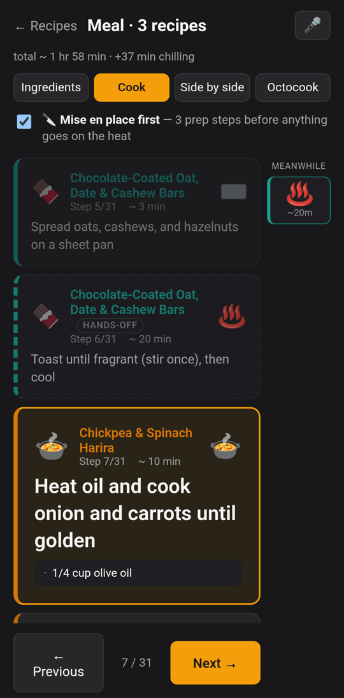
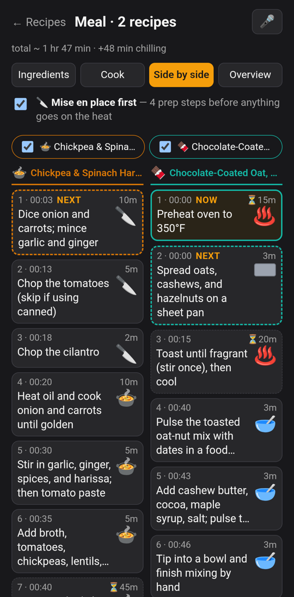
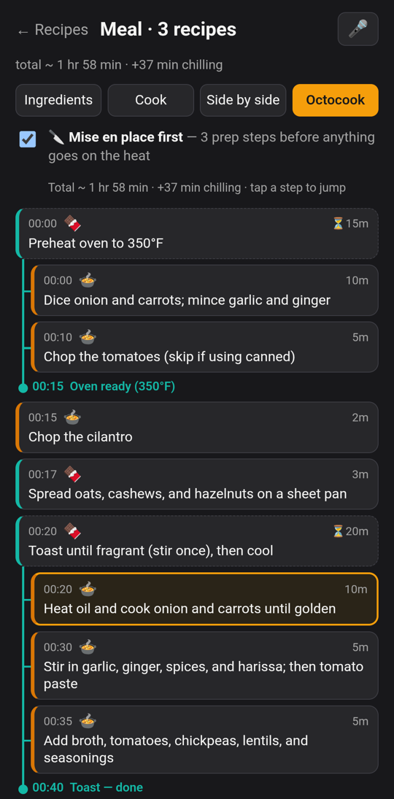
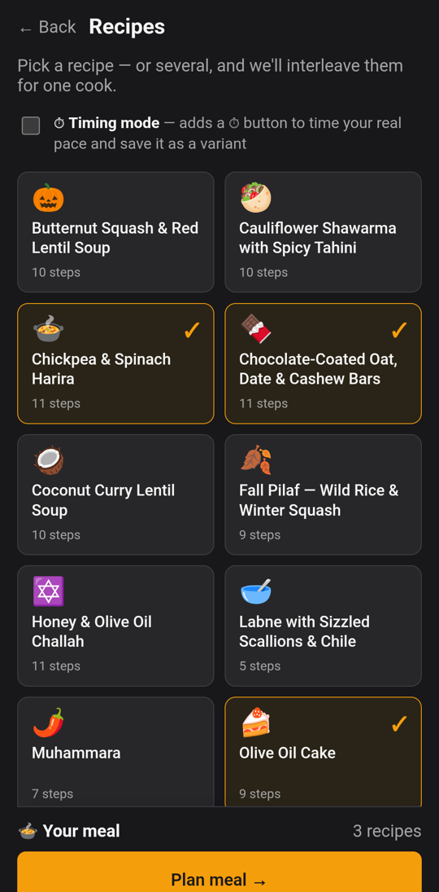
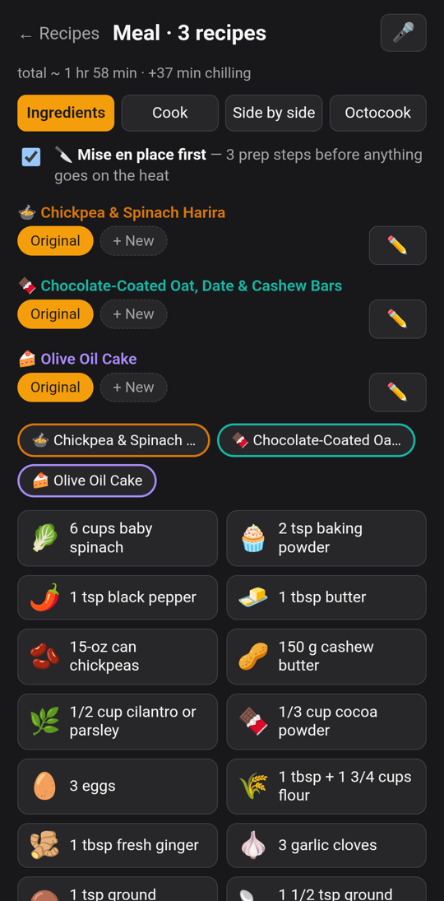

# Octocook
Simultaneous recipe preparation, simplified.

Your friends are coming over for dinner. You're planning to prepare some muhammara, a cucumber salad, a pot of harira, and an olive oil cake for dessert. Each recipe is easy on its own, but together they're a puzzle: the cake needs the oven for 45 minutes, the soup needs an hour on the stove, everything needs chopping, and you only have two hands, one oven, and four burners.

Octocook takes the recipes you want to make, breaks each one into small timed steps, and weaves them into a single plan for the cooks and tools you actually have — chop the cucumbers while the oven preheats, stir the soup together while the cake bakes — so everything is ready at the same time. Then it walks you through the plan one step at a time on your phone.

<table>
  <tr>
    <td align="center"><br><sub><b>Cook</b> — one step at a time, with what's going on in the background</sub></td>
    <td align="center"><br><sub><b>Side by side</b> — where you are in each recipe</sub></td>
    <td align="center"><br><sub><b>Overview</b> — the whole interleaved plan</sub></td>
  </tr>
</table>

## What it does today

- **Plans a meal.** Pick one recipe or several; Octocook interleaves their steps to finish as early as possible, respecting your kitchen (how many burners, pans, bowls, ovens…) and swapping in substitutes for tools you don't own (no stand mixer → hand mixer, takes a bit longer).
- **Walks you through it.** A big, readable current step with its ingredient amounts and the tool you'll need, the previous step grayed out, the next ones coming up, and a "meanwhile" rail showing what's baking or simmering in the background. The screen stays on, and you can say "next" instead of touching the phone.
- **Shows the whole plan four ways:**
  - **Ingredients** — everything you need for the meal, merged across recipes.
  - **Cook** — one step at a time.
  - **Side by side** — a column per recipe, with where you are in each and the tool each step needs.
  - **Overview** — the interleaved schedule as a graph: a preheat or simmer draws a line down the side until "Oven ready", with the work you do meanwhile indented under it.
- **Keeps sautés together.** A run of hands-on stovetop steps from one recipe (onions → garlic → spices) is never broken up by other work; a covered simmer frees you up for something else.
- **Mise en place mode.** Optionally do all the chopping, peeling, and washing up front before anything goes on the heat.
- **Honest times.** Totals are reported the way recipes state them — "~1 hr 30 min · +1 hr chilling" — with cooling and do-ahead waits (an overnight soak) shown separately.
- **Learns your pace.** Edit any recipe, save personal variants ("Alice's"), and optionally time yourself cooking so your variant uses your real durations.

## How it works

```
recipe URL or cookbook photos
        │  tools/add_recipe.py      scrape the page, or read photos with Claude vision
        ▼
Notion page + JSON-LD block         the canonical recipe
        │  tools/enrich_recipe.py   Claude splits instructions into timed steps
        ▼                           (duration, hands-on or not, tools, dependencies)
cookSteps in the JSON-LD
        │
        ├─ tools/schedule.py / server/   Python scheduler (OR-Tools CP-SAT), multi-cook
        └─ web/ (phone app)              same model as a fast offline heuristic
```

Each step is a fixed-length task. Hands-on steps occupy a cook; hands-off ones (baking, rising, simmering) don't. Every tool is a limited resource from your kitchen's inventory, the oven is held by one recipe at a time (so nobody preheats to a different temperature mid-bake), and steps wait for the steps they depend on. The scheduler minimizes the time until everything is done.

## Getting started

Python 3.10+ and Node are required. Recipes live in a Notion database — see [CLAUDE.md](CLAUDE.md) for the properties it needs.

```bash
python3.12 -m venv .venv
.venv/bin/pip install -r tools/requirements.txt -r server/requirements.txt
cp tools/.env.example tools/.env      # NOTION_API_KEY, NOTION_RECIPES_DB_ID, ANTHROPIC_API_KEY
cd web && npm install
```

### Add and enrich recipes

```bash
cd tools
python add_recipe.py https://cooking.nytimes.com/recipes/12345 -y
python add_recipe.py page1.jpg page2.jpg --source "Salt Fat Acid Heat" -y   # from cookbook photos
python enrich_recipe.py "Roast Chicken with Lemon" -y                       # or: python enrich_all.py
python schedule.py "Roast Chicken with Lemon" "Caesar Salad" "Olive Oil Cake"
```

### The phone app (offline)

The Android app runs entirely on the phone — recipes are bundled from `web/src/recipes/*.json` (each a recipe's `cookSteps`, copied from Notion) and scheduled on-device. With the phone plugged in and USB debugging on:

```bash
cd web
npm run build && npm run android:sync && npm run android:run
```

Open it, tap **View a recipe (offline)**, and pick what you're making.

<table>
  <tr>
    <td align="center"><br><sub>Pick one recipe, or several</sub></td>
    <td align="center"><br><sub>Ingredients, variants, and the time it'll take</sub></td>
  </tr>
</table>

### The full app (multiple cooks)

The FastAPI server plans with the CP-SAT scheduler, assigns every hands-on step to a specific cook, and tracks progress per cook:

```bash
cd server && ../.venv/bin/uvicorn app:app --reload --port 8000   # terminal 1
cd web && npm run dev                                            # terminal 2 → http://localhost:5173
```

[CLAUDE.md](CLAUDE.md) has the details: running it on a phone over Wi-Fi, the scheduler model, kitchen presets and substitutions, and the parity check that keeps the offline scheduler honest (`npm run check-parity`).

## Layout

| Path | What's there |
|---|---|
| `tools/` | Ingest, enrich, and schedule CLIs; the CP-SAT scheduler; kitchen inventory and substitutions |
| `server/` | FastAPI backend for multi-cook sessions (SQLite for progress) |
| `web/` | React + Vite app, wrapped for Android with Capacitor; offline scheduler in `src/lib/scheduler.ts` |
| `scripts/` | Scheduler parity fixtures and Notion maintenance |

## Roadmap

The original wishlist, and where each item stands.

**Planning**
- [x] Backed by a Notion database of recipes
- [x] Group recipes into a meal
- [x] Choose how many cooks are helping (full app; the phone app plans for one)
- [x] Choose your kitchen: which tools you have and how many
- [x] Schedule every step of every dish to finish as soon as possible, interleaving dishes
- [x] An estimate of total time

**While cooking**
- [x] The current step is very easy to read
- [x] The screen doesn't go dark
- [x] The last completed step is visible but grayed out
- [x] The next step is visible
- [x] Steps left and percent complete (step counts everywhere; a percent bar in the full app)
- [x] Symbols for the tool each step needs
- [x] Scroll through everything that's coming up
- [x] A symbol for the recipe each step belongs to
- [x] See where a step sits among the rest of its recipe (Side by side)
- [ ] Time each step and learn how fast *you* are, so future plans use your pace — timings can be saved into a personal variant of a recipe today, but aren't yet learned across recipes (chopping onions takes Charlie 3 minutes, not 5, in every recipe)
- [x] Passive steps (preheating, baking) shown alongside the steps that happen during them — the Overview and the "meanwhile" rail
- [x] Ingredient quantities on each step ("1 onion, 4 cloves garlic")

**Cooking party**
- [x] Assign each step of a group meal to a specific cook (full app)
- [ ] Multiple people on multiple devices, each able to check on the others' progress
- [ ] Nudges between cooks: if Bob is dicing onions Alice needs next, tell Bob to say "Alice, I have your diced onions!"

**Recipes**
- [ ] Add and enrich recipes from inside the app, including a one-click "add this recipe" from any blog or website
- [ ] Choose between your own database and a shared one
- [x] Ship with a default set of recipes (bundled in the phone app)
- [ ] Rate recipes, keep notes, and share them
- [ ] Turn a meal into a shopping list stored in Notion (the merged ingredient list exists in the app)
- [ ] Recommend recipes from your database and beyond
- [ ] Run the full app without a laptop on the network (hosted backend, or the CP-SAT planner on the phone)
